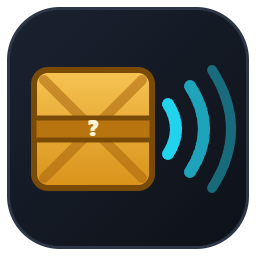

<p align="center"></p>

<h1 align="center">Merchant Ear</h1>
<p align="center"><b>Слух торговца</b> — помощник для полевого торговца в Arena Breakout: Infinite</p>
<p align="center"><a href="README.md">English</a> · <b>Русский</b></p>

У полевого торговца (Field Merchant) грузы закрыты: видно только надпись, цену и размер. Но когда груз перетаскиваешь, он издаёт звук предмета внутри. Merchant Ear слушает этот звук, смотрит на сетку торговца и подсказывает:

- **что может лежать в грузе** — список предметов с вероятностями;
- **шанс красного предмета**;
- **окупится ли покупка** — средняя стоимость против цены, шанс получить дороже, разброс;
- **какие грузы выгоднее всего купить** в этом рейде.

## Возможности

- **Распознавание по звуку.** Звук перетаскивания сравнивается с библиотекой из 38 звуковых групп (189 предметов). Резкость начала звука отсекает ложные срабатывания от ветра и музыки.
- **Груз под курсором.** Клиент передаёт положение курсора: груз, на который вы навели, подсвечивается сразу, а звук относится к тому грузу, который был под курсором в момент нажатия.
- **Схема торговца.** Сетка находится сама, надписи читаются распознаванием текста, из прокрутки собирается схема всего списка; видимая часть обведена. После покупки схема перестраивается сама, «Искать заново» — мгновенно.
- **Точные шансы.** Набор груза определяется по надписи, цене и размеру: в каждом наборе предметы одного размера, поэтому предметы чужого размера отбрасываются. При скидке набор определяется по зачёркнутой цене.
- **Окупаемость и рейтинг.** Для каждого груза с известной ценой: средняя стоимость, шанс окупить, вывод «стоит брать / рискованно / не окупится». Лучшие покупки отмечаются на схеме (#1, #2…, по числу покупок за рейд: 2, 3 или 4). Оценка — по цене сдачи торговцу, полевому торговцу (+10%) или по рынку.
- **Учёт покупок.** Строка «… spent … Koen … obtained […]» и баланс подтверждают вашу покупку; она уточняет вероятности на будущее.
- **Оверлей.** Режим для одного монитора: маленькое окно поверх игры — схема слева, результат и рейтинг справа.
- **Интерфейс** на украинском, английском и русском.

## Как устроено

| Часть | Что делает | Где работает |
|---|---|---|
| [`web/`](web/README.ru.md) | Сайт: всё распознавание (сетка, текст, звук, шансы, окупаемость) идёт в браузере | Любой веб-сервер или `localhost` |
| [`client/`](client/README.ru.md) | Клиент на C# (.NET 10): звук только процесса игры, кадры только её окна, положение курсора — по WebSocket | Игровой ПК с Windows |

```
[веб-сервер или localhost]  раздаёт web/
          │ страница
          ▼
[игровой ПК]  браузер ──ws://localhost:8777──►  MerchantEar.Client.exe ──► звук и окно UAGame.exe
```

Клиент необязателен: без него сайт попросит поделиться экраном с системным звуком (Chrome или Edge на Windows). Но с клиентом звук чище, а груз под курсором определяется точно.

Клиент не читает и не изменяет память и файлы игры: он захватывает звук процесса стандартным механизмом Windows (как OBS и Discord), снимает окно игры и читает системное положение курсора.

## Быстрый старт

Нужны Windows 10 (сборка 20348+) или 11, .NET 10 SDK, Python 3 (или любой другой простой веб-сервер) и Chrome или Edge.

1. Запустите клиент:

   ```bash
   cd client
   dotnet run -c Release
   ```

2. Во втором окне запустите сайт:

   ```bash
   cd web
   python -m http.server 8080
   ```

3. Переключите игру в режим «Окно без рамки» (Borderless), откройте `http://localhost:8080/` и нажмите **«Начать ловлю»**.
4. Откройте полевого торговца и прокрутите список — схема соберётся сама. Наведите курсор на груз, чтобы прочитать цену, и дёрните его — звук уточнит, что внутри.

Как выложить сайт на свой сервер с HTTPS и паролем — в [web/README.ru.md](web/README.ru.md). Настройки клиента — в [client/README.ru.md](client/README.ru.md).

## Ограничения

- Вероятности считаются по таблицам торговца (данные abibuilder.com / abi-tracker) и не являются живой статистикой. Окупаемость — по табличным ценам предметов.
- Многие предметы делят один звук: внутри одной звуковой группы предмет определяется только по весам набора.
- Надписи грузов читаются только на английском клиенте игры. Сетка, звук и цены работают на любом языке.
- Нужен режим «Окно без рамки»: в эксклюзивном полноэкранном режиме кадр получается чёрным.

## Предупреждение

Это фанатский инструмент, не связанный с MoreFun Studios и Tencent. Слушать грузы на слух игра поощряет сама, но EULA Arena Breakout: Infinite (пункты 7(b), 7(c), 7(i)) запрещает сторонние программы, которые собирают информацию об игре или дают преимущество. Используйте на свой риск, не раздавайте сайт публично и не показывайте его на стримах.

## Авторы и лицензия

Merchant Ear распространяется под лицензией **GNU GPL v3.0** — полный текст в файле [LICENSE](LICENSE). Вы можете свободно использовать, изучать, изменять и распространять программу; изменённые версии должны оставаться под той же лицензией и с исходным кодом.

- Merchant Ear — © 2026 Sch1z0eD. Изменённая версия: проект разделён на сайт и клиент, добавлены курсор из клиента, устойчивая связь, защита от шума, окупаемость, рейтинг и многое другое (история изменений — в git).
- Основан на проекте ABI Kaluvan (neverh8me, GPL-3.0) — https://github.com/neverh8me/abi-kaluvan
- [Tesseract.js](https://github.com/naptha/tesseract.js) (Apache-2.0) — распознавание текста, `web/lib/tesseract`.
- Данные торговца и иконки предметов — [abibuilder.com](https://abibuilder.com); звуки предметов — Item Sonar и записи пользователей. Звуки, иконки и данные игры принадлежат их правообладателям и под лицензию проекта не подпадают.
